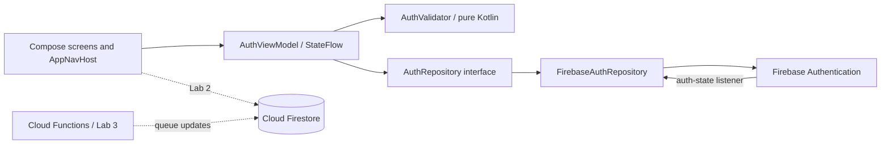

# OfficePulse

OfficePulse helps university students avoid office queues by booking visits and tracking their turn.

## Team

| Member | Responsibilities |
| --- | --- |
| Yazan (`Yazanleva`) | Repository owner, Tech Lead, initial Android/Firebase setup and authentication implementation |
| Naser Almasry (`1naser-git`, student ID 65690) | Product documentation, authentication completion, testing and QA/DevOps |

Both members develop and review code. A member other than the PR author reviews each change before it is merged.

## MVP and scope

| Feature | Delivery |
| --- | --- |
| Register, log in, log out and restore the session | Sprint 1, Lab 1 |
| Browse university offices and their opening hours | Sprint 1, Lab 2 |
| Open an office and book a visit | Sprint 1, Lab 2 |
| View and cancel my visits | Sprint 1, Lab 2 |
| Track my queue position | Later, Lab 3; server-side updates |
| Automatically release expired reservations | Later, Lab 3; scheduled server-side logic |

Maximum five screens: Login, Register, Home (office list), Office detail/booking, and My visits. Lab 1 implements only Login, Register and a temporary Home. The office and visit features are planned, not implemented in this lab.

## First data model

Firebase Authentication owns credentials. Firestore will store application data in Lab 2, in at most three collections:

| Collection | Fields and types |
| --- | --- |
| `users` | `uid` (document ID/string, matches Auth UID), `email` (string), `displayName` (string), `createdAt` (timestamp) |
| `offices` | `name` (string), `building` (string), `room` (string), `openingHours` (string), `serviceMinutes` (number), `isOpen` (boolean) |
| `visits` | `ownerId` (string, Auth UID), `officeId` (string, office document ID), `startAt` (timestamp), `status` (string), `queueNumber` (number), `createdAt` (timestamp), `updatedAt` (timestamp) |

Ownership: `users/{uid}` belongs to that authenticated UID; `visits.ownerId` links each visit to its owner. Office information is shared. Lab 2 Firestore Security Rules must enforce access on the server; hiding buttons in the app is insufficient. Firestore is a planned dependency, not required by the Lab 1 authentication skeleton.

## Architecture



The repository is the only layer calling FirebaseAuth. It exposes session changes through a listener-backed flow and returns `Result<Unit>` from authentication operations. The ViewModel owns form values, validation, loading state and friendly errors. Navigation observes `isLoggedIn`; changing the session recreates the navigation graph and removes the previous session's back stack. Passwords stay in memory and are cleared when authentication succeeds or forms change.

## How to run

1. Clone the repository and check out the branch you want to test.
2. Open the repository folder in Android Studio. Use JDK 25, Android SDK Platform 37 and a recent Google Play emulator (or an Android device, API 26+).
3. Let Gradle sync. The wrapper provides Gradle 9.6.0. Dependency versions are in `gradle/libs.versions.toml`.
4. Keep `app/google-services.json` in the app module. It identifies the existing Firebase project `officepulse-86e4d` and the package `com.officepulse.app`; no service-account private key is needed.
5. The Firebase project owner enables Authentication > Sign-in method > Email/Password. Keep the free Spark plan. Team/instructor access is managed in the existing Firebase project.
6. Run the `app` configuration. Register an account, log out, log in, and restart to check automatic login.

The Firebase client configuration is included for team builds as requested by the handout. Do not commit service-account keys, passwords, tokens or signing keys.

## Checks

From the repository root, with the Android SDK configured:

```powershell
.\gradlew.bat :app:assembleDebug :app:testDebugUnitTest :app:lintDebug
.\gradlew.bat :app:connectedDebugAndroidTest
```

The second command requires a running emulator or connected device. See [the manual test checklist](docs/testing.md) for the real Firebase acceptance tests and [the lab checklist](docs/lab1-checklist.md) for team/repository requirements.

## Workflow

Work on feature branches, open a PR linked to an issue (`Closes #...`), obtain a review from the other member, and squash-merge. The `protect-main` ruleset requires a PR, one approval, and prevents force pushes/deletion. Do not bypass the rules to manufacture two merged PRs. GitHub review history and the sprint board provide the completion evidence.
