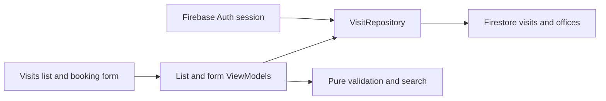
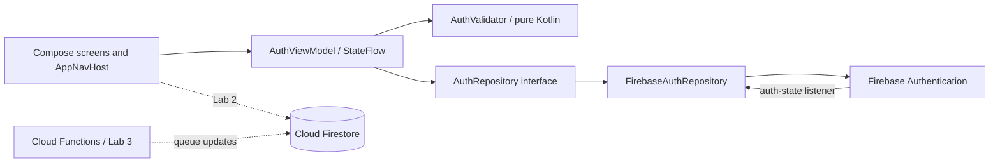

# OfficePulse

This student project uses the Polish/English wordmark from the [Akademia WSB downloads page](https://wsb.edu.pl/uczelnia/do-pobrania). Its pink accent is sampled from the published logo (#CC0C61). The booking directory contains demo offices.

OfficePulse helps university students avoid office queues by booking visits and tracking their turn.

## Run the booking app

OfficePulse is a Kotlin/Compose Android app for booking visits to university offices. Sign in to see your own visits, book an office, change a time or topic, and delete a booking.

| Component | Tool |
| --- | --- |
| App and state | Kotlin, Compose, Navigation Compose, ViewModel and StateFlow |
| Backend and database | Firebase Emulator Suite and Cloud Firestore |
| Authentication | Firebase Authentication, email/password |
| Test tools | JUnit, coroutines-test, Android instrumentation, Node test runner and Firestore rules-unit-testing |

Install Node 22 or 24 with npm, JDK 25, Android SDK 37 and an Android emulator with Google Play. Set JAVA_HOME and ANDROID_HOME. From the repository root:

1. Run `npm ci --prefix backend`.
2. Run `npm --prefix backend start` and leave that terminal open.
3. In a second terminal run `npm --prefix backend run seed`. It creates three offices and prints disposable sign-ins for two local accounts.
4. Start the Android virtual device, run `adb reverse tcp:9099 tcp:9099` and `adb reverse tcp:8080 tcp:8080`, then run `./gradlew :app:installDebug` (Windows: `gradlew.bat :app:installDebug`). Open OfficePulse from the launcher and sign in with either account. Create a booking and switch accounts to compare the lists. The local Emulator UI is at http://127.0.0.1:4000.
5. Run `./gradlew :app:testDebugUnitTest`. With the seeded emulators and Android device running, run `./gradlew :app:connectedDebugAndroidTest -Pandroid.testInstrumentationRunnerArguments.runVisits=true -Pandroid.testInstrumentationRunnerArguments.runRotationCheck=true -Pandroid.testInstrumentationRunnerArguments.runCloudAuth=true -Pandroid.testInstrumentationRunnerArguments.runCloudSessionChecks=true`. Stop the backend before running `npm --prefix backend test` to let the rules suite start its own Firestore instance.

Debug builds use the isolated demo-officepulse emulator project through the two adb reverse ports. Release builds use the Lab 1 cloud client configuration. Cloud Firestore requires the rules and reference records before release use.

### Booking data model

| Collection | Field | Type | Set by |
| --- | --- | --- | --- |
| offices | document ID, name, building | strings | backend seed |
| offices | serviceMinutes | integer | backend seed |
| visits | ownerId | string | app from authenticated UID, immutable under rules |
| visits | officeId, officeName | strings | user selects an office, app copies its ID and canonical name |
| visits | topic | string | user, 1–200 characters |
| visits | startAt, endAt | timestamps | user through native date/time pickers, end after start |
| visits | createdAt | timestamp | server on create |
| visits | updatedAt | timestamp | server on write |
| visits | status, rejectReason | strings | app submits pending with empty reason, server owns the decision |

### Definition of Done

A story is complete after its acceptance checks pass, another member checks it on their device and approves the PR, the PR merges into main and closes the linked issue, and the board reflects that state. A passing local test records technical evidence. Team members record their own reviews and device checks.

### Current architecture



The sections below record the original Lab 1 scope and setup.

## Team

| Member | Responsibilities |
| --- | --- |
| Yazan (`Yazanleva`) | Repository owner, Tech Lead, initial Android/Firebase setup and authentication implementation |
| Naser Almasry (`1naser-git`, student ID 65690) | Product documentation, authentication completion, testing and QA/DevOps |

Both members develop and review code. A member other than the PR author reviews each change before it is merged.

## Project links

- [Public sprint board](https://github.com/users/1naser-git/projects/1) (managed by Naser and readable by the team and instructor)
- [Original authentication PR #2](https://github.com/Yazanleva/1.-officepulse/pull/2)
- [Lab 1 completion PR #3](https://github.com/Yazanleva/1.-officepulse/pull/3), based on `feature/auth`
- [Retro - Lab 1](https://github.com/Yazanleva/1.-officepulse/issues/8)

Sprint 1 stories: [authentication #1](https://github.com/Yazanleva/1.-officepulse/issues/1), [office list #4](https://github.com/Yazanleva/1.-officepulse/issues/4), [booking #5](https://github.com/Yazanleva/1.-officepulse/issues/5), and [My visits #6](https://github.com/Yazanleva/1.-officepulse/issues/6). [Queue and expiry #7](https://github.com/Yazanleva/1.-officepulse/issues/7) are in the Lab 3 backlog.

## MVP and scope

| Feature | Delivery |
| --- | --- |
| Register, log in, log out and restore the session | Sprint 1, Lab 1 |
| Browse university offices and their opening hours | Sprint 1, Lab 2 |
| Open an office and book a visit | Sprint 1, Lab 2 |
| View and cancel my visits | Sprint 1, Lab 2 |
| Track my queue position | Later, Lab 3; server-side updates |
| Automatically release expired reservations | Later, Lab 3; scheduled server-side logic |

Maximum five screens: Login, Register, Home (office list), Office detail/booking, and My visits. Lab 1 implements only Login, Register and a temporary Home. The office and visit features are planned, not implemented in this lab.

## First data model

Firebase Authentication owns credentials. Firestore will store application data in Lab 2, in at most three collections:

| Collection | Fields and types |
| --- | --- |
| `users` | `uid` (document ID/string, matches Auth UID), `email` (string), `displayName` (string), `createdAt` (timestamp) |
| `offices` | `name` (string), `building` (string), `room` (string), `openingHours` (string), `serviceMinutes` (number), `isOpen` (boolean) |
| `visits` | `ownerId` (string, Auth UID), `officeId` (string, office document ID), `startAt` (timestamp), `status` (string), `queueNumber` (number), `createdAt` (timestamp), `updatedAt` (timestamp) |

Ownership: `users/{uid}` belongs to that authenticated UID; `visits.ownerId` links each visit to its owner. Office information is shared. Lab 2 Firestore Security Rules must enforce access on the server; hiding buttons in the app is insufficient. Firestore is a planned dependency, not required by the Lab 1 authentication skeleton.

## Architecture



The repository is the only layer calling FirebaseAuth. It exposes session changes through a listener-backed flow and returns `Result<Unit>` from authentication operations. The ViewModel owns form values, validation, loading state and friendly errors. Navigation observes `isLoggedIn`; changing the session recreates the navigation graph and removes the previous session's back stack. Passwords stay in memory and are cleared when authentication succeeds or forms change.

## How to run

1. Clone the repository and check out the branch you want to test.
2. Open the repository folder in Android Studio. Use JDK 25, Android SDK Platform 37 and a recent Google Play emulator (or an Android device, API 26+).
3. Let Gradle sync. The wrapper provides Gradle 9.6.0. Dependency versions are in `gradle/libs.versions.toml`.
4. Keep `app/google-services.json` in the app module. It identifies the existing Firebase project `officepulse-86e4d` and the package `com.officepulse.app`; no service-account private key is needed.
5. The Firebase project owner enables Authentication > Sign-in method > Email/Password. Keep the free Spark plan. Team/instructor access is managed in the existing Firebase project.
6. Run the `app` configuration. Register an account, log out, log in, and restart to check automatic login.

The Firebase client configuration is included for team builds as requested by the handout. Do not commit service-account keys, passwords, tokens or signing keys.

## Checks

From the repository root, with the Android SDK configured:

```powershell
.\gradlew.bat :app:assembleDebug :app:testDebugUnitTest :app:lintDebug
.\gradlew.bat :app:connectedDebugAndroidTest
```

The second command requires a running emulator or connected device. See [the test guide and verified cloud results](docs/testing.md), [clean screenshots and result records](docs/evidence/README.md), and [the lab checklist](docs/lab1-checklist.md). Real Firebase registration/login/logout, readable errors, restart/session persistence, Back navigation and form retention were verified on 23 October 2026. The remaining sign-off is the other member's review/merge, owner confirmation of Firebase billing/membership, and the classroom demo/retrospective.

## Workflow

Work on feature branches, open a PR linked to an issue (`Closes #...`), obtain a review from the other member, and squash-merge. The `protect-main` ruleset requires a PR, one approval, and prevents force pushes/deletion. Do not bypass the rules to manufacture two merged PRs. GitHub review history and the sprint board provide the completion evidence.
