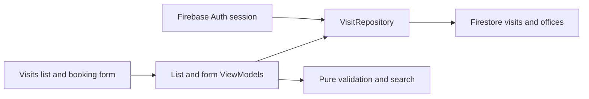

# OfficePulse

This student project uses the Polish/English wordmark from the [Akademia WSB downloads page](https://wsb.edu.pl/uczelnia/do-pobrania). Its pink accent is sampled from the published logo (#CC0C61). The booking directory contains demo offices.

OfficePulse helps university students avoid office queues by booking visits and tracking their turn.

## Run the booking app

OfficePulse is a Kotlin/Compose Android app for booking visits to university offices. Sign in to see your own visits, book an office, change a time or topic, and delete a booking.

| Component | Tool |
| --- | --- |
| App and state | Kotlin, Compose, Navigation Compose, ViewModel and StateFlow |
| Backend and database | Firebase Emulator Suite and Cloud Firestore |
| Authentication | Firebase Authentication, email/password |
| Test tools | JUnit, coroutines-test, Android instrumentation, Node test runner and Firestore rules-unit-testing |

Install Node 22 or 24 with npm, JDK 25, Android SDK 37 and an Android emulator with Google Play. Set JAVA_HOME and ANDROID_HOME. From the repository root:

1. Run `npm ci --prefix backend`.
2. Run `npm --prefix backend start` and leave that terminal open.
3. In a second terminal run `npm --prefix backend run seed`. It creates three offices and prints disposable sign-ins for two local accounts.
4. Start the Android virtual device, run `adb reverse tcp:9099 tcp:9099` and `adb reverse tcp:8080 tcp:8080`, then run `./gradlew :app:installDebug` (Windows: `gradlew.bat :app:installDebug`). Open OfficePulse from the launcher and sign in with either account. Create a booking and switch accounts to compare the lists. The local Emulator UI is at http://127.0.0.1:4000.
5. Run `./gradlew :app:testDebugUnitTest`. With the seeded emulators and Android device running, run `./gradlew :app:connectedDebugAndroidTest -Pandroid.testInstrumentationRunnerArguments.runVisits=true -Pandroid.testInstrumentationRunnerArguments.runRotationCheck=true -Pandroid.testInstrumentationRunnerArguments.runCloudAuth=true -Pandroid.testInstrumentationRunnerArguments.runCloudSessionChecks=true`. Stop the backend before running `npm --prefix backend test` to let the rules suite start its own Firestore instance.

Debug builds use the isolated demo-officepulse emulator project through the two adb reverse ports. Release builds use the Lab 1 cloud client configuration. Cloud Firestore requires the rules and reference records before release use.

### Booking data model

| Collection | Field | Type | Set by |
| --- | --- | --- | --- |
| offices | document ID, name, building | strings | backend seed |
| offices | serviceMinutes | integer | backend seed |
| visits | ownerId | string | app from authenticated UID, immutable under rules |
| visits | officeId, officeName | strings | user selects an office, app copies its ID and canonical name |
| visits | topic | string | user, 1–200 characters |
| visits | startAt, endAt | timestamps | user through native date/time pickers, end after start |
| visits | createdAt | timestamp | server on create |
| visits | updatedAt | timestamp | server on write |
| visits | status, rejectReason | strings | reserved for the later server-decision workflow |

### Definition of Done

A story is complete after its acceptance checks pass, another member checks it on their device and approves the PR, the PR merges into main and closes the linked issue, and the board reflects that state. A passing local test records technical evidence. Team members record their own reviews and device checks.

### Current architecture

## Lab 2 verification and submission

Selected extensions are E1 search across office and topic, E3 empty/no-results states and E4 native date/time pickers. Calendar handoff and quick duration choices are convenience features.

The saved booking uses the same private data model as the original project. This Lab 2 build focuses on CRUD; server decision processing belongs to Lab 3.

See docs/lab2-progress.md for saved checkpoints, verification and remaining team tasks.

## Team

| Member | Responsibility |
| --- | --- |
| Mohamad Yazan Alsaloumi (Yazanleva) | Android implementation, backend setup and technical verification |
| Nasser Almassry (1naser-git) | Assigned review and device-verification work, subject to actual contributions |

Repository: https://github.com/Yazanleva/1.-officepulse

Sprint 2 board: https://github.com/users/Yazanleva/projects/2

Previous Lab 1 board: https://github.com/users/1naser-git/projects/1

Every change requires a peer-reviewed PR linked to an issue. Each teammate must author a meaningful merged PR for Lab 2. The instructor checks the demo and retrospective.
