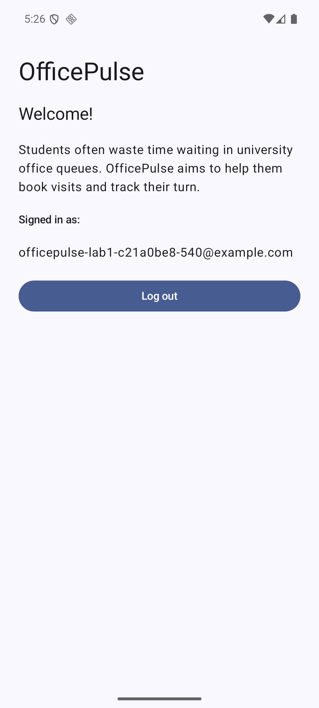
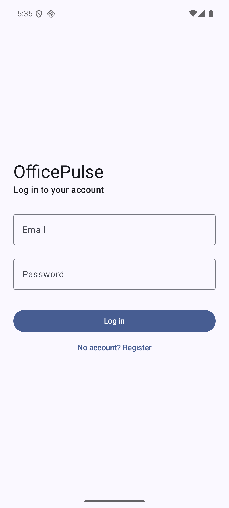

# Lab 1 verification evidence

Verified on 23 October 2026 using the installed OfficePulse app and its existing Firebase project `officepulse-86e4d`.

- `cloud-result.json`: actual server-backed registration, user reload, duplicate email, wrong password, logout and login results.
- `session-result.json`: actual Android Back and restart behavior before and after logout.
- `home-real-firebase.png`: Home after a force-stop/restart with the real test account restored.
- `login-after-logout.png`: Login after logout/restart, with no authenticated Home screen restored.

These are emulator-screen captures, without desktop chrome or a mouse pointer. The displayed email is a generated lab test account, not a personal inbox. Passwords and authentication tokens are not included.

## Signed-in Home after restart

## Login after logout and restart

